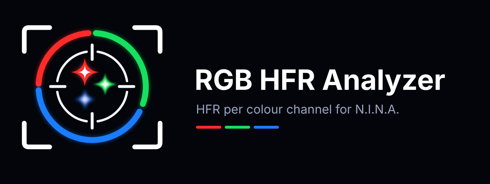
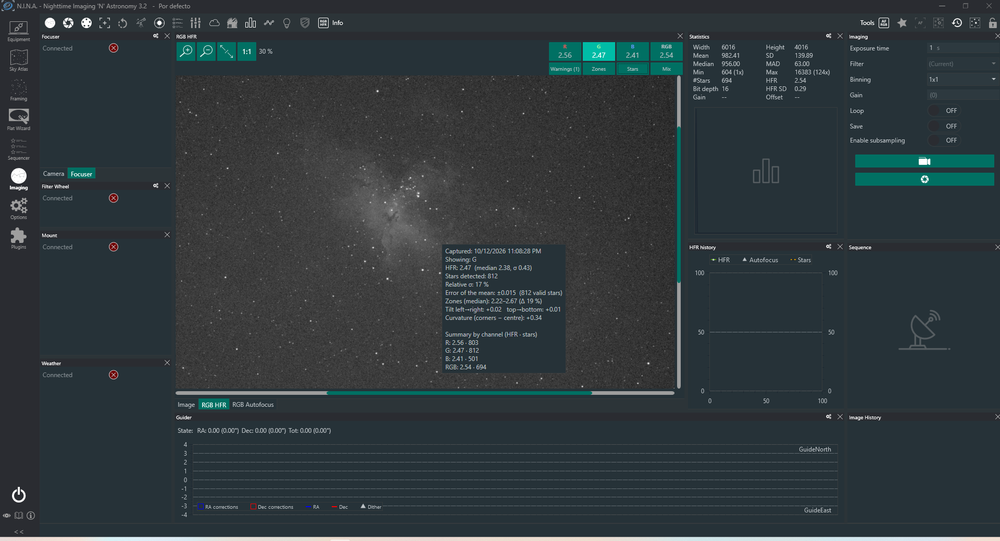

# RGB HFR Analyzer

**See how sharp each colour channel really is. HFR per channel (R, G, B, RGB) and autofocus on the channel that matters, for one-shot-colour cameras, as a plugin for [N.I.N.A.](https://nighttime-imaging.eu/)**

For narrowband and dual-band filters, achromats, ED/APO refractors, reflectors and SCTs alike.

🇪🇸 [Leer en español](README.es.md)

> **Beta.** Tested by its author, but not yet by other users or on a wide range of equipment. Bug reports and feedback are very welcome (see [Issues](../../issues)).

## Table of contents

1. [Why this plugin exists](#why-this-plugin-exists)
2. [Features](#features)
3. [Requirements and installation](#requirements-and-installation)
4. [How it works](#how-it-works)
5. [Usage guide](#usage-guide)
6. [Reading the analysis data](#reading-the-analysis-data)
7. [Automatic warnings](#automatic-warnings)
8. [Limitations](#limitations)
9. [Building from source](#building-from-source)
10. [Credits, licence and AI disclosure](#credits-licence-and-ai-disclosure)

## Why this plugin exists

The HFR that N.I.N.A. shows, and uses for its autofocus, is **one global number**: it mixes the three colour channels of a one-shot-colour (OSC) image. But a colour image is really three images, and they are not always equally sharp. That global HFR cannot tell you **which channel is best focused**, and the autofocus converges to a compromise you cannot influence.

RGB HFR Analyzer gives you that information inside the normal N.I.N.A. workflow, **reusing N.I.N.A.'s own debayer, star detector and autofocus engine**, so the numbers are comparable with the ones the program already shows. It is useful with any telescope:

- **Narrowband and dual/tri-band filters (Ha, Ha+OIII, SII...).** The signal only reaches some channels. With an Ha filter, the useful channel is red, so that is the one to focus on; with Ha+OIII you can compare red against green+blue. Focusing on the channel that carries your signal, instead of a global HFR diluted by channels that receive almost nothing, gives better focus where it counts.
- **Achromatic refractors.** Longitudinal chromatic aberration puts the best focus of red, green and blue at different focuser positions. You can see it, measure it and choose which colour to favour. (Mono cameras focus each filter separately; an OSC camera has only one position per frame.)
- **ED/APO refractors.** Check how much colour residual is left and whether it matters for your imaging.
- **Reflectors, SCTs and corrected systems.** Check that colour has not crept in through IR/UV-cut filters, reducers or flatteners, and use the zone map, tilt and field-curvature diagnostics to tune your imaging train.
- **Curiosity.** It is a simple way to learn how your telescope really behaves at each wavelength.

**What it does not do.** It measures; it does not change your images, and nothing is written to FITS headers or files. It does not remove chromatic aberration either: in the author's tests with an achromatic refractor, focusing each channel separately and recombining them did **not** remove it. What worked best there was focusing on the **R** channel, which left all three channels well focused and far better than the compromise of N.I.N.A.'s global HFR. Your telescope and camera may behave differently, which is exactly why looking at each channel is useful.

## Features

| Feature | Where | Description |
|---|---|---|
| **Per-channel analysis** | *RGB HFR* panel | HFR and detected stars for R, G, B and RGB, for every image (saved or not). |
| **Channel viewer** | *RGB HFR* panel | Image of the selected channel with zoom, pan and optional circles on the detected stars. |
| **Zone map** | *RGB HFR* panel | Optional 3×3 grid with the HFR of each zone. |
| **Statistics pop-up** | *RGB HFR* panel | Mean and median HFR, σ, error of the mean, tilt and field curvature, shown when hovering over the image. |
| **Warnings** | *RGB HFR* panel | Only when something important is detected. Hidden by default. |
| **Channel mixes** | *RGB HFR* panel | Analyse several channels at once (average), e.g. R+B for intermediate focus. |
| **Per-channel autofocus** | *RGB Autofocus* panel | N.I.N.A.'s own autofocus (same curve and graph) measuring the channel you choose, or the average of two channels. |
| **Best position table** | *RGB Autofocus* panel | Best focuser position found for each channel, with a **Go** button to move there. |
| **Use in all autofocus runs** | *RGB Autofocus* panel | Makes every N.I.N.A. autofocus (including the sequencer) measure the chosen channel. |
| **Sequencer instruction** | Advanced sequencer | *Channel Autofocus*. |
| **Sequencer trigger** | Advanced sequencer | *Channel Change and Refocus*, with a plan of steps. |
| **File name pattern** | Options > Imaging | `$$FOCUSCHANNEL$$`: channel of the last autofocus, to sort frames by focus channel. |
| **Languages** | Options > Plugins | English and Spanish, following N.I.N.A.'s language by default. |

## Requirements and installation

**Requirements**

- N.I.N.A. **3.2** or later (developed and tested with 3.2.0.9001).
- A **colour camera with a Bayer matrix** (OSC). With mono cameras the panel tells you the image is not a colour image.
- Windows 10/11 x64 (what N.I.N.A. requires).

**Installation**

- *From the N.I.N.A. plugin manager* (once published): open **Plugins > Available**, find *RGB HFR Analyzer* and press **Install**. While the plugin is in beta it may only be listed in the beta channel.
- *Manually*: close N.I.N.A., download the `.zip` from the [Releases](../../releases) page, extract the DLL into a folder inside `%localappdata%\NINA\Plugins\3.0.0\` and start N.I.N.A.

**Where the panels are.** In the Imaging tab, top bar: **Info** → *RGB HFR* (analysis) and **Tools** → *RGB Autofocus*. Panels can be docked, moved or floated like any other N.I.N.A. panel.

## How it works

### Analysis of each image

Every time N.I.N.A. prepares an image for display (saved or not), the plugin analyses it in the background, without delaying capture or saving:

1. **Debayer** with N.I.N.A.'s own debayer to get the R, G and B channels at full resolution.
2. **One channel, one image:** each channel is treated as a monochrome image.
3. **Stretch** with the stretch settings of your N.I.N.A. profile.
4. **Detection** with **N.I.N.A.'s star detector**, using the sensitivity, noise reduction and crop settings of your profile.
5. **Result:** mean HFR, deviation, number of stars and star list for that channel.

The **RGB** channel follows the same path as N.I.N.A.'s main image (debayered colour image, then detection), so its HFR and star count match N.I.N.A.'s own. Each channel detects **its own stars**; the number of stars can differ between channels (blue usually has less signal). HFR is expressed in **pixels of the full sensor**, as in N.I.N.A.

### Channel mixes

With **Mix** on you can select two channels (for example R+G): both are averaged and the result goes through the same process. This is a simple average, not your real processing: it is for comparing combinations, not for predicting the final result.

### Per-channel autofocus

The plugin does **not** include its own autofocus engine. It provides a **star detector** (*RGB HFR Analyzer (active channel)*) that measures the chosen channel, and N.I.N.A.'s autofocus uses it as it would use its own. The V-curve, fitting, steps, attempts, graph and all *Options > Autofocus* settings are unchanged.

The detector only acts **during an autofocus run**. Everywhere else, including the HFR that N.I.N.A. shows for every image, it behaves like N.I.N.A.'s own detector on the whole image.

Two ways to use it:

- **From the *RGB Autofocus* panel:** the plugin selects its detector for the duration of the autofocus and then restores the previous one.
- **Global mode:** with *Use this channel in all NINA autofocus runs*, the plugin's detector stays selected and any N.I.N.A. autofocus (manual, legacy or advanced sequencer, time, temperature or HFR triggers) measures the chosen channel.

## Usage guide

### *RGB HFR* panel (analysis)

**Top row.** Zoom buttons on the left (zoom in, zoom out, fit to window, 1:1) and the **R**, **G**, **B** and **RGB** buttons on the right, each showing its HFR. RGB is selected by default. Hover over a button to see how many stars were detected in that channel.

**Second row (on/off buttons, all off by default).**

- **Warnings:** shows the red warning box when something important is detected; the button shows how many (for example *Warnings (2)*).
- **Zones:** overlays a 3×3 grid with the HFR of each zone, coloured from blue (sharper than the global median) to red (softer). Hover over a zone for its statistics.
- **Stars:** draws a circle around every detected star in the channel shown.
- **Mix:** lets you select several channels at once. With it off, each button selects a single channel. The **RGB** button always selects all three.

**Statistics.** Hover over the image to see capture date and time, the channel shown, mean and median HFR, σ, number of stars, relative σ, error of the mean, zone range, tilt, curvature, and a summary of all four channels.

**Viewer.** Mouse wheel to zoom (centred on the cursor), drag to pan, or use the zoom buttons. The image is a reduced (max. 3000 px wide), already stretched version, so it looks softer at high zoom than in N.I.N.A.

### *RGB Autofocus* panel

1. Choose the **channel to focus**: R, G, B, RGB (same as N.I.N.A.'s normal autofocus), or R+G, G+B, R+B (average of two channels, for focus between them).
2. Press **Start autofocus** (camera and focuser must be connected). You can **Cancel** at any time.
3. The graph is N.I.N.A.'s own. The table on the right keeps the position, HFR and time of the last autofocus of each channel, with a **Go** button to move the focuser there.
4. Optionally tick **Use this channel in all NINA autofocus runs (including the sequencer)**.

The chosen channel is remembered between sessions.

### File name pattern

In **Options > Imaging > File pattern** you will find `$$FOCUSCHANNEL$$` (category *RGB HFR Analyzer*). It contains the channel of the last autofocus done with this plugin (`R`, `G`, `B`, `RGB`, `RG`, `GB` or `RB`). Together with N.I.N.A.'s own `$$FOCUSERPOSITION$$` you can sort frames by focus, for example:

`$$DATE$$\$$TARGETNAME$$_$$FOCUSCHANNEL$$_$$FILTER$$_$$FOCUSERPOSITION$$_$$EXPOSURETIME$$s_$$FRAMENR$$`

If you run N.I.N.A.'s own autofocus without the plugin, the pattern keeps the previous channel.

### Sequencer

**Advanced sequencer**, category **RGB HFR Analyzer**:

- **Channel Autofocus:** runs N.I.N.A.'s autofocus instruction measuring the channel chosen in its drop-down.
- **Channel Change and Refocus:** a trigger with a **plan of steps**. Each step has a channel and a number of LIGHT exposures. When a step is complete, before the next exposure, it switches to the next step's channel and runs the autofocus on it. **+** and **−** add or remove steps; **Repeat the plan** goes back to the first step after the last; **Focus at start** runs an autofocus on the first channel before the first exposure.

**Legacy sequencer.** Plugins cannot change its screens, so there is no channel selector in its autofocus block. Use **global mode** of the *RGB Autofocus* panel instead: all its autofocus runs will measure the chosen channel.

### Language

By default the interface follows N.I.N.A.'s language (Spanish, otherwise English). You can force one in **Options > Plugins**; restart N.I.N.A. to apply it. Names of sequencer items are always in English.

## Reading the analysis data

| Data | What it is | How to read it |
|---|---|---|
| **HFR** | Typical star size, in pixels. | Lower is sharper. Compare channels of the same frame. |
| **Stars** | Stars passing the detector in that channel. | A sharper channel usually detects more. Few stars → unreliable measurements. |
| **Median** | Central HFR value among stars. | Less sensitive to odd stars (doubles, false detections) than the mean. |
| **σ** | Spread of the HFR between stars. | How much star sizes vary. |
| **Relative σ** | σ divided by the mean HFR. | Lets you compare dispersion between channels. |
| **Error of the mean** | σ / √N. | Uncertainty of the mean HFR. A difference between channels is reliable if it exceeds about 3 times its error. |
| **Zones (min–max)** | HFR of the best and worst zone of the 3×3 grid. | Δ below ~10 %: fairly uniform field. |
| **Tilt** | HFR difference between sides (right−left, bottom−top). | Close to 0 is good. If large and repeated across frames, check the sensor is perpendicular to the optical axis. |
| **Curvature** | Corner HFR minus centre HFR. | Positive: corners are worse (field curvature, coma). Common in refractors without a flattener. |

Notes:

- Zone cells use each zone's **median** (each zone has few stars). The channel buttons show the **mean**, which is what N.I.N.A. computes, so they can differ slightly. Zone pop-ups show both.
- Zones with fewer than 5 stars are not computed; tilt and curvature require at least 10 stars per group.
- Everything comes from **one image**: wind, guiding or seeing can enlarge stars momentarily. A real problem repeats across several frames.
- A channel with a higher HFR can still be the best focused one, depending on filter and exposure: judge focus by eye and with the HFR of the buttons, not by the numbers alone.

## Automatic warnings

The red box appears **only** if one of these conditions is met (in any analysed channel). Thresholds are indicative:

| Warning | Condition |
|---|---|
| **Tilt** | Difference between sides above 10 % of the HFR and statistically real (more than 3 times its error). If it repeats in several channels, a mechanical cause is likely. |
| **Marked field curvature** | Corners more than 20 % worse than the centre, and statistically real. |
| **Centre worse than corners** | More than 10 % in favour of the corners; unusual. |
| **Few stars** | Fewer than 100 usable stars in some channel. |
| **High dispersion** | Relative σ above 35 %. |

There is no warning for one channel being better focused than another: with an achromatic refractor that is normal, and it is what the plugin helps you study.

## Limitations

- **Colour (Bayer) cameras only.** With mono cameras there are no channels to split.
- **Analysis time.** Each image needs several detections (R, G, B and RGB) in the background: several seconds with 24 MP images. If another image arrives while the previous one is being analysed, it is skipped.
- **Memory.** The R, G and B channels of the last image are kept in memory (about 150 MB with 24 MP) to compute mixes on demand.
- **Autofocus takes a little longer** because the channel has to be extracted and stretched before detection.
- **Blue usually has less signal:** its focus curve can be noisier; you may need a longer exposure for the autofocus.
- **Detector selected in the profile.** N.I.N.A. stores the selected star detector in the profile. If N.I.N.A. is closed in the middle of an autofocus started from the panel, the plugin's detector could stay selected; fix it in *Options > Imaging > Star detector*.
- **Focus drifts with temperature.** Positions saved per channel can become obsolete if the temperature changes a lot, and the table is not kept after closing N.I.N.A.
- **Sequencer trigger.** It counts LIGHT exposures in the image history: if the history is cleared the plan starts again. If an autofocus fails the plan does not advance and retries before the next exposure.
- **N.I.N.A. versions.** The plugin uses the N.I.N.A. 3.x API; future versions may need adjustments.
- **Code comments** are mostly in Spanish.

## Building from source

1. Install **Visual Studio 2022 or later** with the .NET desktop workload.
2. Clone the repository and open the solution (`RGBfocus.slnx`; the project keeps its original name).
3. The project uses the `NINA.Plugin` NuGet package, restored automatically.
4. Close N.I.N.A. and build (**Rebuild Solution**). The build copies the plugin to N.I.N.A.'s plugin folder.
5. Start N.I.N.A. and check its log (`%localappdata%\NINA\Logs`) for `Successfully loaded plugin RGB HFR Analyzer`.

The `NU1701` warnings about `ToastNotifications` and `VVVV.FreeImage` are normal: they are N.I.N.A. dependencies built for .NET Framework. To publish a release, see [docs/RELEASING.md](docs/RELEASING.md).

## Credits, licence and AI disclosure

- Plugin by **Antonio Aguado Rovira**.
- Built on the plugin API of **N.I.N.A. – Nighttime Imaging 'N' Astronomy**, open source under the MPL 2.0 licence. The plugin reuses N.I.N.A.'s star detector, debayer and autofocus engine, and contains one small function adapted from N.I.N.A.'s code (Bayer pattern shift from the camera offsets).
- **AI disclosure:** this plugin was developed with substantial help from an AI assistant (Claude, by Anthropic), which wrote most of the code under the author's direction. The author reviewed it, tests it on real equipment and maintains it.
- Licence: **MPL 2.0** (see `LICENSE.txt`).

N.I.N.A. is an independent project of its authors and contributors; this plugin is not affiliated with or officially endorsed by them.
